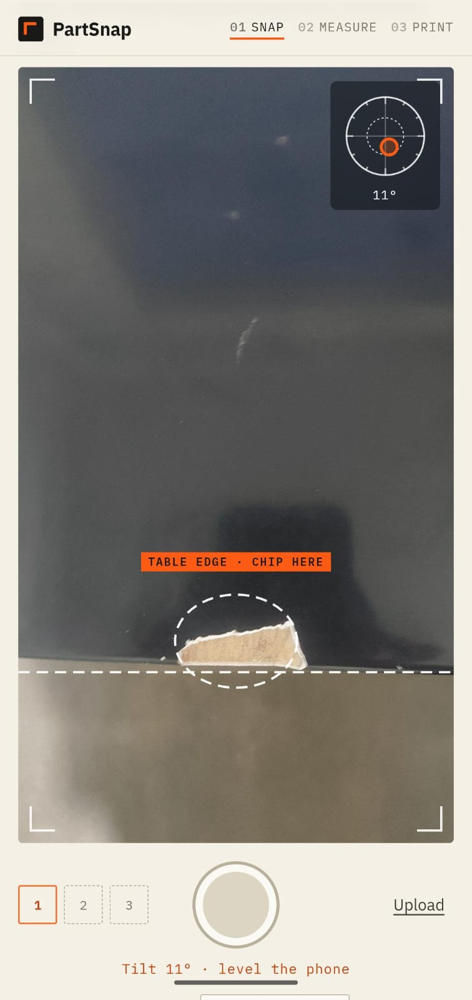
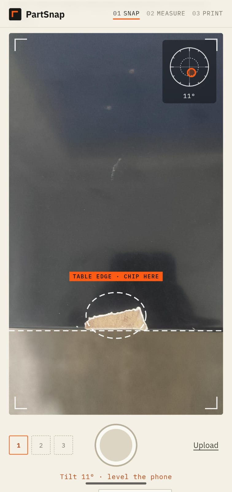
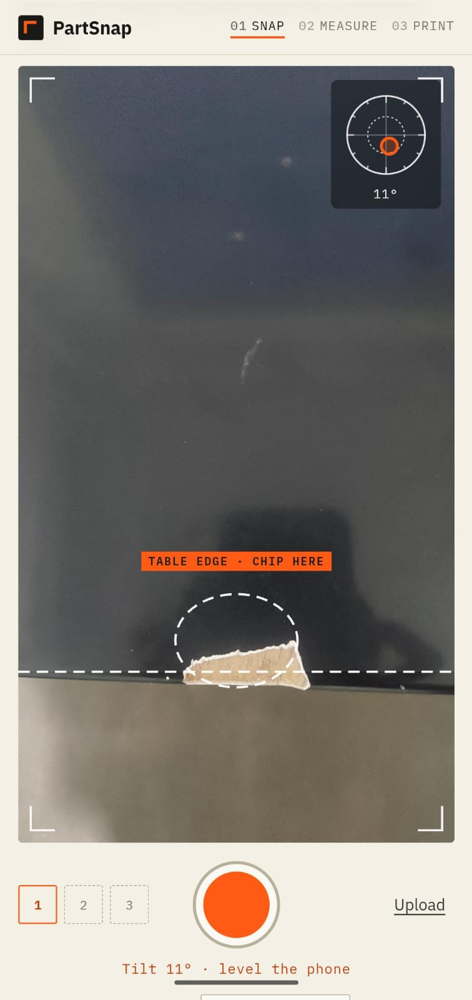
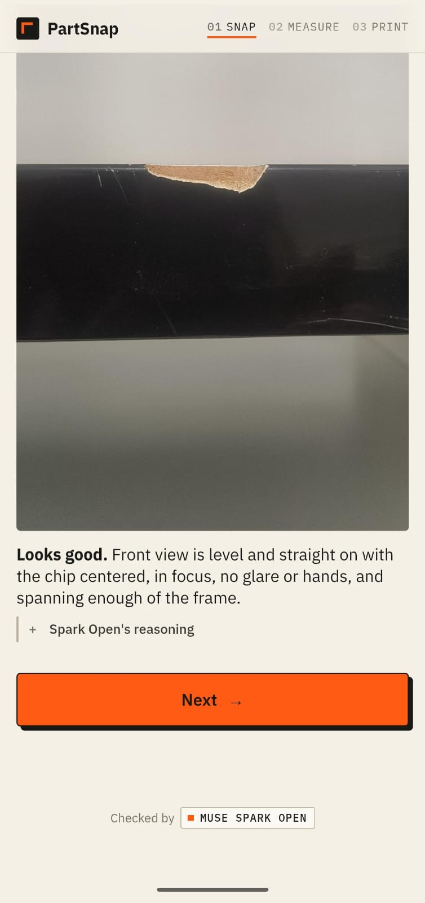
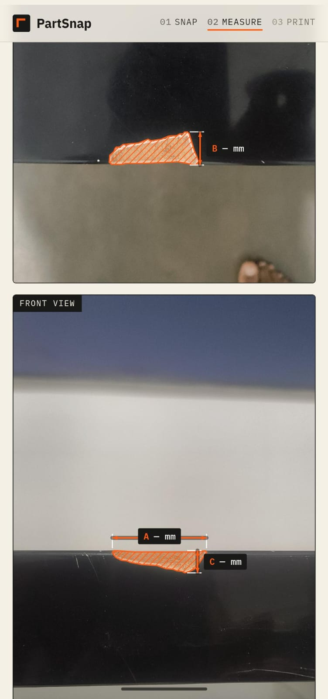
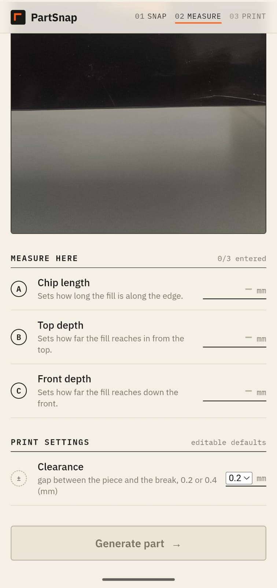
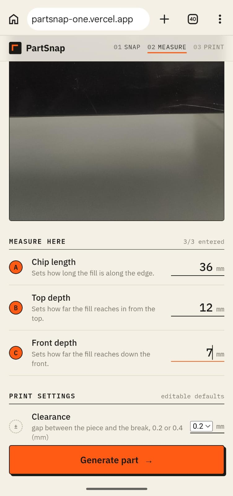
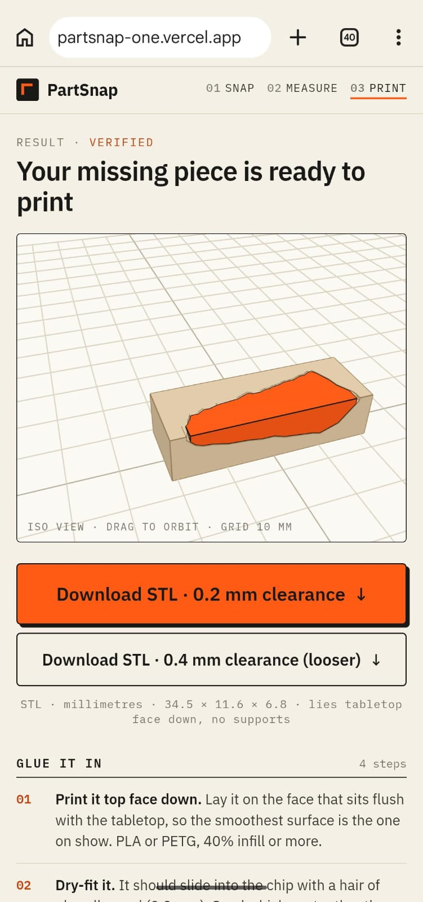

# PartSnap

**Snap a photo of something broken. Print the part that fixes it.**

## Problem statement
**Push the Frontier: manufacturing & repair.** Small breakages, like a chipped table corner, usually get thrown away or left alone because designing a replacement part takes CAD skills. PartSnap turns a few guided photos and 2–3 ruler measurements into a verified, 3D-printable fix.

## How it works
1. **Guided capture**: a shot list (top view, side view, damage close-up) with ghost frames and a live tilt level.
2. **Photo check**: Muse Spark confirms each shot shows the right view and the damage, or asks for a retake.
3. **Segmentation**: SAM 3.1 outlines the missing area in the top view and the side view.
4. **Diagnosis**: Muse Spark picks the fix type and marks where to measure: the edge thickness, which scales both outlines to millimetres, and the chip depth.
5. **CAD generation**: Muse Spark Open (Baseten) writes CadQuery code: extrude the top outline vertically, the side outline horizontally, intersect them, and shrink the result by the clearance (0.2 mm) with break features under 1 mm flattened.
6. **Verify loop**: the code runs sandboxed. The piece must be one watertight body with zero overlap with the remaining wood, a gap close to the clearance, and a fill ratio (piece volume ÷ missing volume) of at least 90%. Failures go back to the model for repair (max 3 attempts).
7. **Preview + download**: the piece seated in the chip in a three.js preview, the STL, and how to glue it in.

Fix types: **chip fill** (the default), the exact missing piece of a chipped corner, glued back in; and **corner cap**, an L-shaped cap that slides over the corner.

## Screenshots


*Guided capture: ghost frame on the table edge with a live tilt level.*


*Another capture take lined up on the chip.*


*Chip inside the ghost frame; shutter ready.*


*Photo check: Muse Spark Open confirms the shot, with its reasoning.*


*SAM outlines with the A/B/C dimension lines to measure.*


*Measure screen before entering the three dimensions.*


*Measurements entered, clearance set, ready to generate.*


*Verified result: the piece seated in the chip, STL downloads, glue-in steps.*

## Deployment
Backend hosted on Modal (`backend/modal_app.py`, deploy with `scripts/deploy_backend.sh`); frontend on Vercel.

## Setup
```
cd backend && python3.12 -m venv .venv && .venv/bin/pip install -r requirements.txt
cp .env.example .env          # MOCK_MODE=1 runs the whole app on saved responses
.venv/bin/uvicorn app:app --port 8000
cd ../frontend && npm i && npm run dev   # open the Network URL on your phone
```

## Built during the hackathon (Oct 26 – Nov 4, 2026)
Everything in this repo was built during the Meta Global AI Developer Hackathon. The commit history is the build log.
